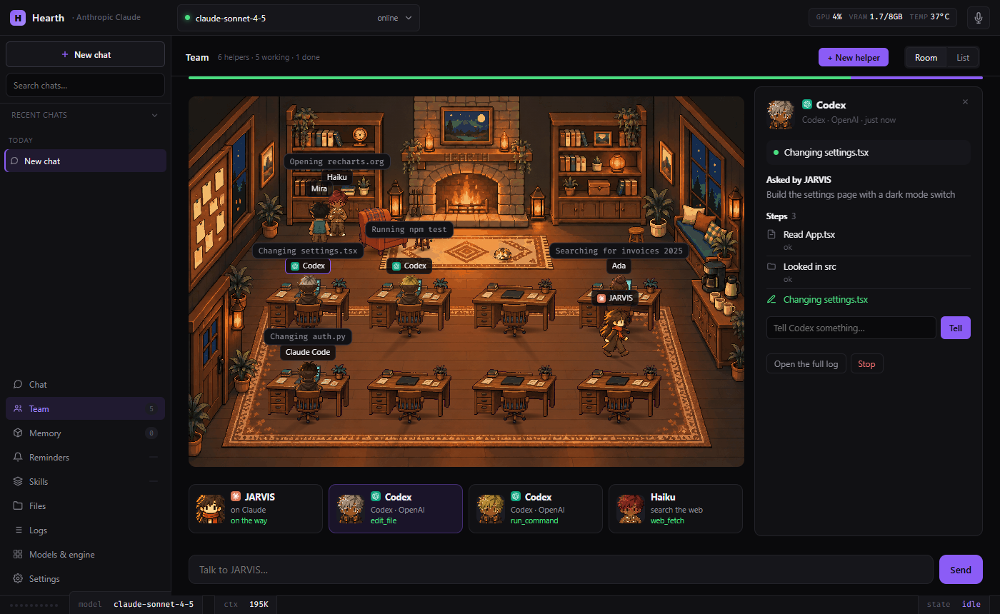
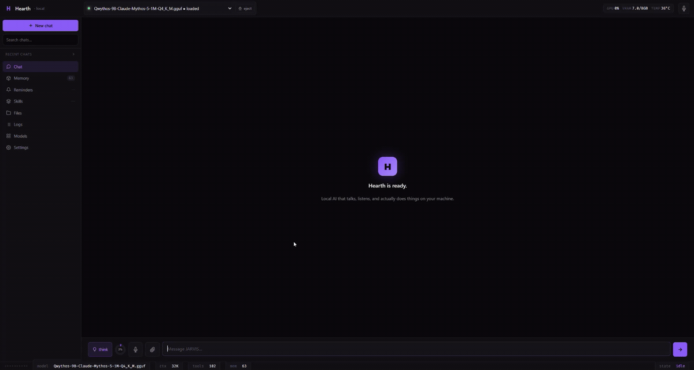
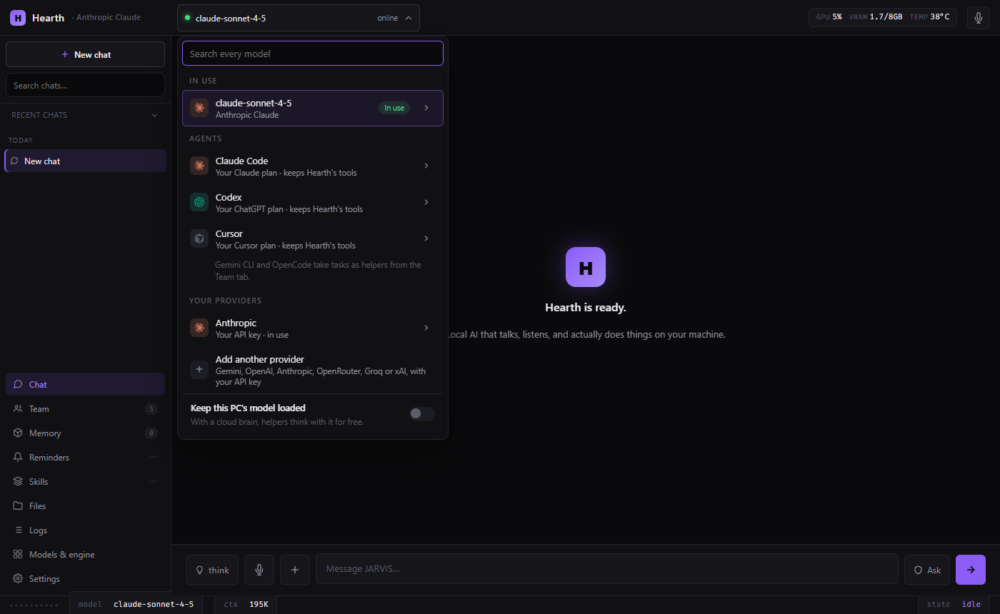
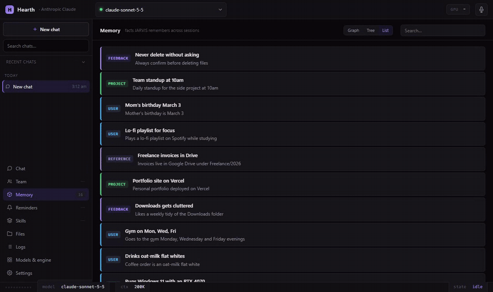
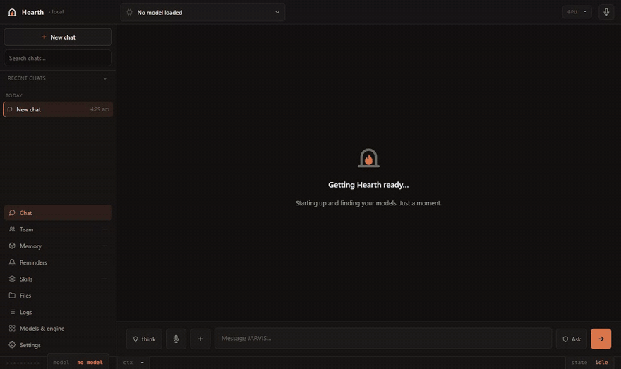

<h1 align="center">Hearth</h1>

<p align="center">
  <strong>Your own JARVIS, running on your own PC.</strong>
</p>

<p align="center">
  It talks, listens and remembers you. It opens your apps, works in your files, drives a browser you can watch and clicks through the desktop for you. It thinks with a model on your machine, a cloud model, or the Claude Code, Codex or Cursor plan you already pay for. When a job is big, it hands parts to helpers and you watch them work in a little pixel cabin.
</p>

<p align="center">
  <a href="https://github.com/0pen-sourcer/hearth/releases"></a>
  <a href="https://github.com/0pen-sourcer/hearth/releases"></a>
  <a href="https://get-hearth.vercel.app"></a>
  <a href="docs/USER_GUIDE.md"></a>
  <a href="LICENSE"></a>
</p>

<p align="center">
  Free and MIT licensed. Windows, with macOS and Linux from source. No account, no telemetry.
</p>

<p align="center">
  
</p>

---

I built Hearth at 17 because I wanted the assistant from the films, the one that knows you and actually does things, and nothing I could run on my own PC came close. Chat apps can't touch your machine. Coding agents stay inside a code folder. Cloud assistants forget you when the tab closes.

Hearth is the framework. JARVIS is the assistant it comes with, and you can rename it to anything. It runs on whatever brain you give it, keeps its memory on your disk, and asks before it does anything risky.

## Get started in three steps

1. **Download** [Hearth for Windows](https://github.com/0pen-sourcer/Hearth/releases/latest). Full (about 1 GB) brings its own model server; Lite (about 500 MB) is for when you already run LM Studio, Ollama or a cloud key. Both install to your user folder without admin rights.
2. **Pick a brain.** Setup finds what you already have, an agent like Claude Code or Codex, a model file on your disk, or a running LM Studio or Ollama, and offers it. You can also download a model from inside the app, or paste a cloud key.
3. **Talk to it.** Type, or press the mic and speak. Ask it to find a file, tidy your Downloads, read a PDF, fix a test, or start a team on something bigger.

> **Windows Defender may flag the installer.** Hearth isn't code-signed yet, and unsigned Python apps sometimes trip Defender's machine-learning check (`Program:Win32/Contebrew.A!ml`). It is a false positive, and the app's whole source is in this repo. If it happens, restore the file from Windows Security, Protection history. Signed builds are planned.

## See it

<table>
<tr>
<td width="50%" align="center"><strong>It does the thing, on your desktop</strong><br></td>
<td width="50%" align="center"><strong>One menu for every brain</strong><br></td>
</tr>
<tr>
<td width="50%" align="center"><strong>A memory that tidies itself</strong><br></td>
<td width="50%" align="center"><strong>Find and run a model without leaving the app</strong><br></td>
</tr>
</table>

---

## What's in it

### Your PC

Hearth reads and writes files, including PDF, Word, Excel, PowerPoint, EPUB and archives, and it can work through a PDF hundreds of pages long. It runs PowerShell commands, opens any app, file, folder or link, and drives a real Chrome, Edge or Brave window you can watch while it clicks and types. Beyond the browser it reads a window's buttons and fields by name and operates the desktop itself, with the real cursor moving. It takes screenshots and, with a model that can see, tells you what is on them. It searches the web without an API key, sets reminders in plain words ("every weekday at 9am"), sends email if you set it up, and runs long jobs like a whole-drive search in the background while you keep talking.

### Brains

A model on this PC through the built-in llama.cpp server, LM Studio, Ollama, vLLM or anything OpenAI-compatible. A cloud model with your own key from Anthropic, OpenAI, Google Gemini, OpenRouter, xAI or Groq. Or **Claude Code, Codex or Cursor**, on the plan you already pay for and with no API key. Other agents that speak the Agent Client Protocol can be the brain once installed, such as OpenCode, Copilot CLI, Goose and Grok Build; OpenCode has been run this way, the others follow the protocol. JARVIS thinks with the agent and still uses Hearth's tools, memory and voice. You switch between all of them from one menu at the top of the window, mid-conversation, without restarting. A model on this PC can stay loaded under a cloud brain, so helpers keep working for free.

### Helpers and the Team room

Bigger jobs go to helpers. One sentence starts a mixed team, like "three on Codex for the frontend, two on Claude Haiku for the tests, one on this PC for the docs". Each helper walks into the Team room, sits at a desk and works, and clicking anyone shows who asked, the task and every step so far. You can tell a working helper something or stop it, helpers message each other and JARVIS as they go, and each report comes back to JARVIS. An agent program working in a git repository gets its own copy, and its changes wait for you to bring them in, discard them or undo them. Past eight helpers the next room opens, and there is a winter cabin, a library and an ocean room besides the first. Helpers can also be other agent programs, each on your own install and account. Claude Code, Codex, Cursor and OpenCode have been run from Hearth; it has adapters for 19 more, among them Gemini CLI, Copilot CLI, Aider and Goose, written from each one's documented headless mode and not yet run here. Starting a helper by hand shows the ones on your PC and how to get the rest.

### Voice

Press the mic and talk. Speech-to-text (faster-whisper) and text-to-speech (Kokoro) both run on your machine, on the graphics card when there is one. Talk over a reply and it stops on your first word and answers what you said instead. It works best on a headset; speaker setups are still being sharpened.

### Memory and skills

Every fact JARVIS learns is a small markdown file in your workspace that you can read, edit or delete. The ones that matter to your message are brought in automatically, ones that are never used are archived rather than deleted, and a new fact that overlaps an old one updates it. Every past chat is searchable. A skill is a folder that teaches a workflow, like making a PDF, a slide deck or a spreadsheet, and installing someone else's is one line, `/skill install owner/repo`. See [docs/SKILLS.md](docs/SKILLS.md) and [awesome-hearth-skills](https://github.com/0pen-sourcer/awesome-hearth-skills).

### Everywhere else

The terminal app (`hearth.bat`) does everything the window does, with slash commands and voice, and the two share one set of chats: start one in the terminal and carry it on in the window. Message it from your phone through a Telegram or Discord bot you set up in a minute, or an experimental WhatsApp bridge ([docs/PHONE.md](docs/PHONE.md)); reminders can also push to your phone through ntfy. It is an MCP server, so LM Studio, Claude Desktop or Cursor can use its tools, and an MCP client, so other servers' tools appear beside its own. A headless mode drives it from scripts. It can also write a new tool for itself when it hits a gap.

### Safety

A switch beside the send box decides what runs without asking. **Ask** checks before anything acts on your machine. **Auto-edit** lets edits inside the workspace through. **Auto** runs routine work on its own and still asks before anything that deletes, moves, sends, uploads, pushes, publishes or installs. Writes are confined to the workspace folder unless you allow another one, and Hearth never runs elevated.

---

## Which model to use

On this PC, any model of about 7B or larger that was trained for tool calling works. The Models tab marks each file by whether it fits your graphics card and points at the right size for it. Small local models handle everyday work well (open this, read that, remember this) and can lose the thread on long multi-step jobs; a loop guard catches them when they start repeating. For deep research or long coding work, a cloud model or an agent brain is the better pick, and you can switch for one task and back.

Hearth reads the tool-call formats of Gemma, Hermes, Qwen, Llama, Mistral, Phi, Granite and Command-R, so a model whose server doesn't parse its tool calls still works.

## How it compares

OpenClaw and Hermes are agents that go wide, across many messaging channels. OpenClaw recommends WSL2 on Windows, and Hermes controls a desktop only through a Linux add-on. Open WebUI and LM Studio are places to chat with a model, and LM Studio can use Hearth's tools through MCP. Hearth goes deep on one Windows PC. It controls the desktop itself, runs the agents you already pay for as its brain or as helpers, and keeps everything on your disk.

## FAQ

**Is it free, and does it work offline?** Yes and yes. With a local model it is fully offline except web search, which only runs when the model looks something up.

**Will it mess with my files?** Writes, moves and deletes stay inside the workspace folder (`~/Jarvis`) unless you allow another folder, and the approval switch decides what asks first. Set `HEARTH_LOCKDOWN=1` to keep reads inside the workspace too.

**What do I need?** Windows 10 or 11. For local models, an NVIDIA card with 8 GB of memory runs a 7B to 9B model well; less works on the CPU, slowly. With a cloud key or an agent brain, any PC that runs a browser is enough.

**Can it replace ChatGPT?** For talking, looking things up and working on your own files and apps, on a good brain, yes. On a small local model it is quicker to set up than it is clever, so pick the brain to match the job.

**What leaves my PC?** Only what you turn on. That means your messages to the cloud model or agent you pick, web searches, and the phone bridges or email you set up. Nothing goes to me. There is no telemetry. Hearth also asks GitHub for its own updates, the npm registry for updates to agents you have installed, and once a day reads the public models.dev catalog for the model details in the model menu; none of these send anything about you.

**Why "Hearth"?** It's the warm center of the house. JARVIS lives there.

---

<details>
<summary><strong>Install from source (Windows, macOS, Linux)</strong></summary>

Needs Python 3.11 or newer.

```powershell
git clone https://github.com/0pen-sourcer/Hearth.git
cd Hearth
.\install.ps1                      # bring your own server (LM Studio, Ollama, vLLM, llama.cpp or a cloud key)
.\install.ps1 -BuiltinLLM cuda     # NVIDIA card: Hearth installs and runs its own llama.cpp server
.\install.ps1 -BuiltinLLM cpu      # no card: the same server on the CPU
.\hearth.bat                       # start the terminal app
python -m hearth.tray --open       # start the window
```

The installer is safe to run again and can skip optional parts (voice, speech-to-text, the MCP SDK, file readers, the window, browser control); `Get-Help .\install.ps1 -Detailed` lists them. Started on Lite and want the built-in server later? Run the Full installer over it and your settings, memory and chats stay where they are.

On macOS and Linux the terminal app and the web window work, and most tools (shell, files, screenshots, apps, windows, clipboard, web, reminders, notifications) have native paths there. Linux is tested on Mint 22 and Ubuntu 24.04; macOS has had less testing. Desktop control and the installer are Windows only for now. Steps are in [docs/INSTALL_LINUX_MAC.md](docs/INSTALL_LINUX_MAC.md).

Hearth finds a running LM Studio (port 1234), Ollama (11434) or llama.cpp server (8080) on its own. For anything else, set `LOCAL_API_BASE` to an OpenAI-compatible address.

</details>

<details>
<summary><strong>Ways to run it</strong></summary>

| | Start it with | |
|---|---|---|
| **Window** | `Hearth.exe`, or `python -m hearth.tray --open` | Chats, Team room, memory, models, settings, voice |
| **Terminal** | `.\hearth.bat` | Everything the window does, with slash commands and voice |
| **Headless** | `python -m hearth.headless --prompt "..."` | JSON lines out, for scripts, CI or another agent; `--format text` for people |
| **MCP server** | `python -m hearth.mcp_server` | Hearth's tools inside LM Studio, Claude Desktop, Cursor or Cline |

</details>

<details>
<summary><strong>How it works</strong></summary>

```
   you (mic) ──▶ faster-whisper ──┐
   you (keys) ──────── text ──────┤
                                   ▼
                     Hearth (window / terminal / bridge)
                                   │  messages + tools
                                   ▼
          a model on this PC, a cloud model, or Claude Code / Codex / Cursor
                                   │  reply + tool calls
                                   ▼
                              tool executor
            files · shell · apps · browser · desktop · web · memory
           + skills + plugins + other MCP servers + helpers (Team room)
                                   │
                                   ▼  (loops until done; a loop guard stops spirals)
   you (ears) ◀── Kokoro ◀── streamed reply
```

Hearth has over a hundred tools, but only a core set goes to the model in full each turn. It sees the names of the rest and loads one when it needs it, so the prompt stays small. `HEARTH_ALL_TOOLS=1` loads everything up front. The full list is in [docs/TOOLS.md](docs/TOOLS.md).

</details>

<details>
<summary><strong>Where things live on disk</strong></summary>

```
~/Jarvis/                  the assistant's home (HEARTH_WORKSPACE moves it)
├── soul.md                who it is, written by itself, read every turn
├── rules.md               your house rules, read every turn
├── memory/                one markdown file per fact, MEMORY.md as the index, _archive/ for cold ones
├── logs/                  what it did, by day
├── voices/                Kokoro and Whisper model files
├── plugins/               tools it wrote, or you did
├── subagents/             each helper's transcript
└── PDFs/ · PPTX/ · XLSX/  documents it made
```

</details>

<details>
<summary><strong>Settings you can set from the environment</strong></summary>

| Variable | Default | |
|---|---|---|
| `LOCAL_API_BASE` | found on its own | An OpenAI-compatible address |
| `LOCAL_API_KEY` | none | The key for it, if it needs one |
| `LOCAL_MODEL` | found on its own | The model name to use |
| `HEARTH_WORKSPACE` | `~/Jarvis` | Where memory, logs and voices live |
| `HEARTH_LOCKDOWN` | `0` | `1` keeps reads inside the workspace too |
| `HEARTH_AUTO_APPROVE` | `0` | `1` skips approval prompts |
| `HEARTH_EXTRA_WORKSPACES` | none | More folders it may write in |
| `HEARTH_VOICE` | `am_michael` | Kokoro voice |
| `HEARTH_VOICE_SPEED` | `1.0` | How fast it speaks |
| `HEARTH_STT_DEVICE` | found on its own | `cpu` or `cuda` for speech-to-text |
| `HEARTH_WAKE_WORD` | none | Listen only after this word |
| `HEARTH_BUILTIN_PORT` | `1234` | Port for the built-in server |
| `HEARTH_COMPACT_AT` | `0.75` | Sum up old turns past this much of the context |
| `HEARTH_NO_ONBOARDING` | `0` | `1` skips setup |
| `HEARTH_PERSONA_NAME` | `JARVIS` | The assistant's name |
| `HEARTH_PERSONA` | none | Tone: `bro`, `chill`, `professional` or `formal` |
| `HEARTH_ALL_TOOLS` | `0` | `1` loads every tool up front |
| `HEARTH_NTFY_TOPIC` | none | [ntfy](https://ntfy.sh) topic for reminders on your phone |

`JARVIS_*` names work too.

</details>

<details>
<summary><strong>Terminal commands</strong></summary>

```
/help        every command                     /team       helpers working for me
/status      what's thinking, context, limits  /agents     agent programs on this PC
/brain       switch what thinks                /mem        what I remember
/model       pick a model on the current brain /skill      skills
/models      models on disk and downloads      /voice      speaking: on, off, speed, mic
/mode        ask, edits or auto                /listen     talk instead of typing
/allow       let me write under a folder       /think      reasoning on, off, or how hard
/compact     sum up old turns now              /phone      reach me from your phone
/context     set the context window            /update     get a newer version
/import-memory   bring memory from ChatGPT or Claude
```

`@path` attaches a file. The full list, with every command, is in the [user guide](docs/USER_GUIDE.md#the-terminal).

</details>

---

## Contributing

Good first pull requests are macOS and Linux versions of the Windows-only tools in [`hearth/tools.py`](hearth/tools.py), more voices in [`hearth/voice.py`](hearth/voice.py), and new tools (a function plus its entry in `TOOL_DEFINITIONS`). See [CONTRIBUTING.md](CONTRIBUTING.md) and the [Roadmap](ROADMAP.md).

## Privacy

Hearth runs on your machine and collects nothing. There is no account, no analytics and no server of mine in the loop. What leaves your computer is only what you turn on, and it goes to the service you chose, whether that is a cloud model or agent, web search (DuckDuckGo), ntfy, the phone bridges or email. With a local model and none of those set up, Hearth is fully offline. The [MIT license](LICENSE) is the whole agreement.

## Support

Hearth is free and built by one person. Ways to help it along are in [docs/SUPPORT.md](docs/SUPPORT.md).

## License

[MIT](LICENSE) © [@0pen-sourcer](https://github.com/0pen-sourcer).

## Thanks

[llama.cpp](https://github.com/ggml-org/llama.cpp) for the built-in server, [Kokoro](https://github.com/thewh1teagle/kokoro-onnx) for the voice, [faster-whisper](https://github.com/SYSTRAN/faster-whisper) for listening, and the [Model Context Protocol](https://modelcontextprotocol.io) for tool interop.
